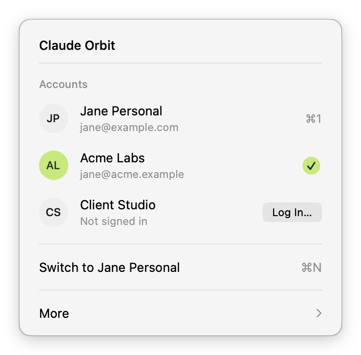
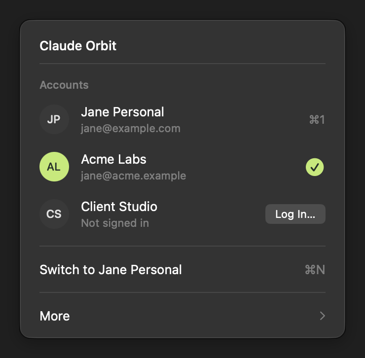
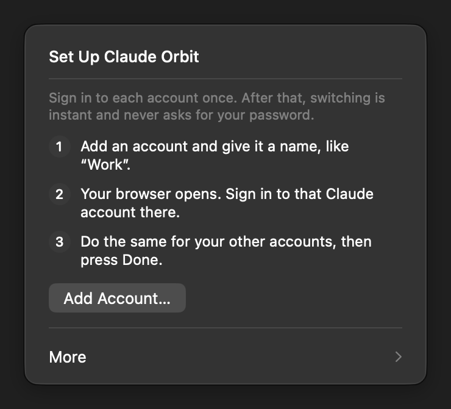

# Claude Orbit

Use several Claude accounts with [Claude Code](https://claude.com/claude-code) and switch between them in one click from the Mac menu bar. When one account runs out of usage, switch to the next and carry on in the same conversation. You sign in to each account once; after that there are no repeat logins and no password prompts.

<p>
  
  
</p>

## Install

You need a Mac running macOS 14 or later, with Claude Code already installed.

### The easy way: ask Claude

Open Claude Code and paste this:

```text
Install Claude Orbit for me from https://github.com/daniyalishaq1/claude-orbit

Clone it to ~/claude-orbit, read its CLAUDE.md, then run ./install.sh.
If the installer asks for anything, walk me through it in plain steps.
When it finishes, tell me how to add my accounts.
```

Claude downloads it, runs the installer and tells you what to click next. You don't need to know how to code.

### By hand

Open the Terminal app and run these three lines:

```sh
git clone https://github.com/daniyalishaq1/claude-orbit ~/claude-orbit
cd ~/claude-orbit
./install.sh
```

If the installer says Apple's Command Line Tools are missing, run `xcode-select --install`, click **Install** in the window that opens, wait for it to finish, and run `./install.sh` again. Those tools are free and a few hundred megabytes; the full Xcode app isn't needed.

Keep the `~/claude-orbit` folder. The app and the commands run from it.

## Add your accounts



1. Click the new Claude Orbit icon in the menu bar, at the top right of your screen.
2. Click **Add Account…** and give the account a name, like "Work".
3. Your browser opens. Sign in to that Claude account there.
4. Do the same for each of your other accounts, then press **Done**.

That's the only time you sign in. The account you were already using keeps working throughout.

## Everyday use

| You want to… | Do this |
|---|---|
| Switch account | Click the menu-bar icon, then the account. With the menu open, ⌘1–⌘9 pick an account and ⌘N goes to the next one. |
| Keep going after hitting the limit | In the terminal, type `cnext`. It switches to the next account and continues your conversation. |
| Add another account | Menu-bar icon → **More** → **Add Account…** |
| Rename or remove an account | Right-click it in the menu |
| Get the latest version | Menu-bar icon → **More** → **Check for Updates…** |
| Quit | Menu-bar icon → **More** → **Quit Claude Orbit** |

The initials next to the menu-bar icon show which account is in use.

Sessions that are already running keep the account they started with; only new `claude` sessions use the account you switched to. After continuing a long conversation on a new account, run `/compact`: the first message re-reads the whole conversation, which counts against that account's usage.

<details>
<summary>Terminal commands</summary>

| Command | What it does |
|---|---|
| `claude-switch` | List accounts |
| `claude-switch work` | Switch to the account named "work" |
| `claude-switch next` | Switch to the next signed-in account |
| `cnext` | Switch to the next account and run `claude --continue` |
| `claude-switch add "Work"` then `claude-switch login work` | Add an account and sign in |
| `claude-switch rename <id> "New name"` / `claude-switch remove <id> --yes` | Rename or remove |
| `claude-switch update` | Get the latest version and reinstall |
| `claude-switch import-claudeswitcher you@example.com --label "Work"` | Import an account saved by ClaudeSwitcher.app |

</details>

## Updates

The app looks for a new version on GitHub when it starts and from time to time after that. When there is one, **Update Available** appears in the menu; click it and the app downloads the update, rebuilds itself and restarts. You can also check any time under **More** → **Check for Updates…**.

Updates are never installed without that click.

## Uninstall

```sh
cd ~/claude-orbit
./install.sh --uninstall
```

This removes the app, the commands, the line it added to `~/.zshrc` and the Conductor setting. Your accounts stay in `~/.claude-accounts`; delete that folder to remove them too. To also sign them out, run `claude-switch remove <id> --yes` for each one first.

## Troubleshooting

- **No icon in the menu bar.** Run `./install.sh` again from `~/claude-orbit`. If your menu bar is full, macOS hides icons behind the notch; quit another menu-bar app to make room.
- **"Apple's Command Line Tools are needed".** Run `xcode-select --install`, finish the installation, then run `./install.sh` again.
- **`claude-switch: command not found` or `cnext: command not found`.** Open a new terminal window. The commands load when a terminal starts.
- **An account says "Not signed in".** Click **Log In…** beside it and approve in the browser.
- **You moved or deleted the `~/claude-orbit` folder.** Download it again to the same place and run `./install.sh`.
- **Something else.** Open Claude Code in `~/claude-orbit` and describe the problem. `CLAUDE.md` in that folder tells Claude how the tool works.

## What it changes on your Mac

The installer:

- links two commands, `claude-switch` and `claude-for-conductor`, into `~/.local/bin`
- adds one line to `~/.zshrc`
- builds the menu-bar app into `~/Applications` and starts it when you log in
- if [Conductor](https://conductor.build) is installed, points it at the account-aware launcher, unless you already set your own

It backs up every file it edits, and running it again is safe.

Your logins are never read, copied or sent anywhere. Each account gets its own folder, and Claude Code stores and refreshes that account's login itself. The tool only chooses which folder new Claude Code sessions use.

## How it works

Tools that switch accounts by overwriting Claude Code's single saved login cause two problems: macOS asks for your password whenever Claude Code reads the rewritten login, and a Claude Code session that's still running can write its own login back over the one you just switched to.

Claude Orbit gives each account its own Claude Code config folder (`CLAUDE_CONFIG_DIR`) instead. Claude Code keeps a separate keychain item for each folder.

```
~/.claude-accounts/
  accounts.json        accounts, in switching order
  active               id of the active account
  <id>/                CLAUDE_CONFIG_DIR for that account
    .claude.json       its own (holds the account identity)
    skills -> ~/.claude/skills      shared entries are symlinks into ~/.claude
    projects -> ~/.claude/projects  (conversation history + memory)
    …
```

- **Shared across accounts:** skills, plugins, settings, hooks, `CLAUDE.md`, memory and conversation history. Every account feels like the same Claude Code, and `--continue` and `--resume` work across accounts. MCP servers and per-project settings are copied to the account you switch to.
- **Terminal:** a hook in `~/.zshrc` sets `CLAUDE_CONFIG_DIR` for the active account before every prompt.
- **Other apps:** `launchctl setenv` sets it for apps opened afterwards.
- **Conductor:** runs `claude-for-conductor`, which sets the variable and then starts Conductor's own Claude Code. A chat continues on the new account at its next message.
- **The app:** has no account logic of its own. It calls `claude-switch … --json`.

## Known limitations

- macOS only, and the terminal hook is for zsh (the default shell on a Mac).
- claude.ai connectors (Slack, Gmail and so on) come from whichever account is signed in, so they differ between accounts.
- MCP servers that use OAuth need authorising once per account.
- To remove an MCP server, remove it under each account. Switching copies servers between accounts, so one removed under only one account comes back from the others.

## Development

```sh
./test.sh            # CLI (Python unittest), shell and installer tests. No real keychain or accounts are touched.
app/build.sh         # builds app/build/Claude Orbit.app
(cd app && swift make-icon.swift)   # rebuilds Resources/AppIcon.icns from Resources/MenuBarIcon.svg (the menu-bar mark)
"app/build/Claude Orbit.app/Contents/MacOS/ClaudeOrbit" --preview-window dark   # the menu in a window, for screenshots
# Add `bg-light` or `bg-dark` to put a plain window behind it (how the menu looks over a light or dark app),
# and CLAUDE_ACCOUNTS_SHOT=/path/prefix to have the app write prefix.png, prefix-below.png and prefix-menubar.png itself.
# On macOS 26+ the preview is drawn on Liquid Glass, like the real menu. Check colour changes there, over both
# backdrops: glass replaces system colours such as Color.green with much brighter variants.
```

Notes on how Conductor runs Claude Code are in [docs/conductor-notes.md](docs/conductor-notes.md).

## Licence

[MIT](LICENSE). Free to use, change and share.

Claude Orbit is an independent project. It is not made by, affiliated with or endorsed by Anthropic. "Claude" and "Claude Code" are trademarks of Anthropic.
